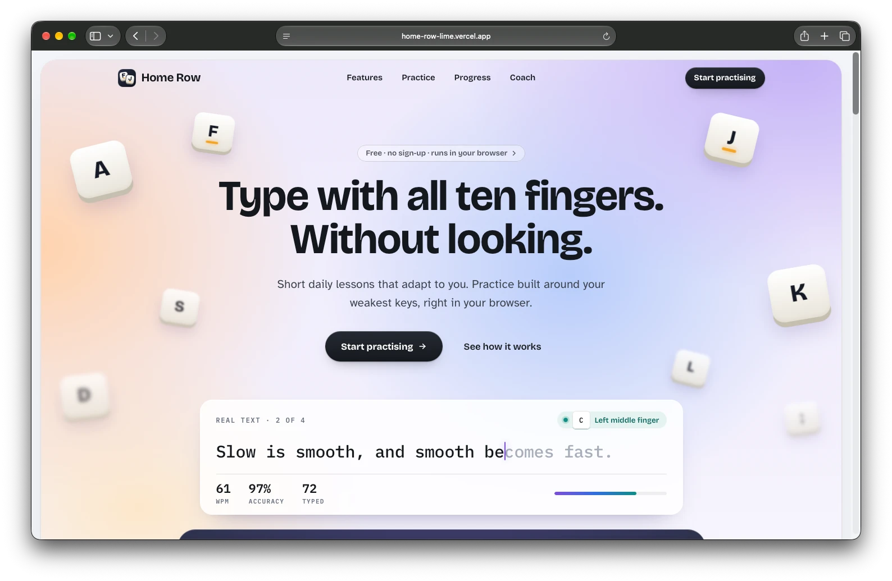
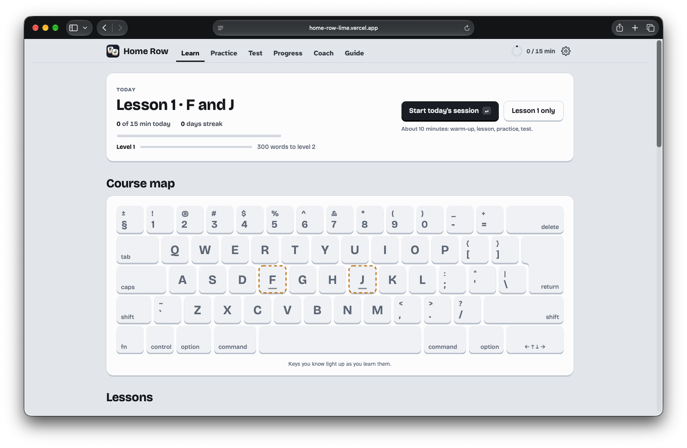
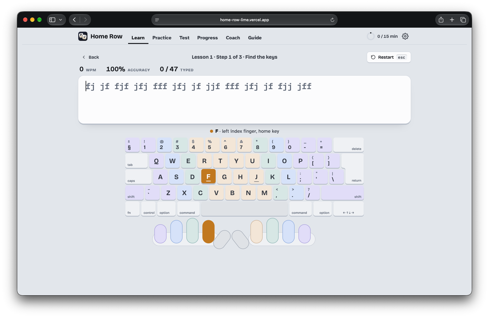

# Home Row

A free touch-typing trainer that runs in the browser. Learn to type with all ten fingers, without looking.

**Try it:** [homerow.sebthe.dev](https://homerow.sebthe.dev)



<p>
  
  
</p>

- **22 lessons**: home row, top row and bottom row, then capitals, punctuation and numbers. A one-minute typing check at
  the start gives you a personal plan.
- **Adaptive practice**: every round is built around your weakest key or letter pair.
- **Real typing**: 40 short passages, 25 code snippets (JavaScript, Python, Swift, CSS, SQL, shell), or your own text.
- **Tests**: 15, 30, 60 or 120 seconds, with a share card for your result.
- **Rewards**: levels, a daily streak, 21 achievements and a weekly recap.
- **Key sounds**: Soft, Creamy, Clicky and Typewriter, made in the browser with no audio files.
- **Claude coach**: copy your progress into a Claude chat, get lessons written for your weakest keys, and paste the reply
  back. The lessons appear in the Coach tab.

Progress is saved in your browser. There is no account and no server.

## Stack

Vite, React 19, TypeScript, Tailwind CSS 4 and [shadcn/ui](https://ui.shadcn.com) (Radix), with Lucide icons and
Sonner toasts. Vitest for tests, Playwright for end-to-end checks.

## Layout

```
index.html            landing page entry (prerendered at build time)
app/index.html        trainer entry, served at /app/
src/
  core/               framework-free logic: lessons, text generation, progress store, scoring, achievements,
                      coach, claude.ai sync, sounds, share card (golden tests in core/__golden__)
  ui/                 imperative pieces that update on every keystroke: typing engine, SVG keyboard, count-up
  components/         Header, Keyboard, TypingStage, dialogs (Settings, Welcome, Share, Move), charts
  components/ui/      shadcn/ui components
  views/              the tabs: Learn, Session, Practice, Test, Progress, Coach, Guide
  landing/            the landing page sections and its typing demo
  styles/             theme tokens (globals.css) and the hand-tuned CSS for keyboard, stage and charts
public/assets/        icon, link preview image
scripts/              prerender, claude.ai page build, golden recorder, end-to-end suites (scripts/e2e)
docs/                 screenshots for this README
```

## Develop

```sh
npm install
npm run dev          # http://localhost:5173 (landing) and http://localhost:5173/app/ (trainer)
npm test             # unit and golden tests
```

End-to-end suites need a running server, for example `npx vite --port 5199`, then
`REACT_URL=http://localhost:5199/app/ node scripts/e2e/phase3.mjs` (also `phase4a.mjs --quick`, `phase4b.mjs` and
`phase5.mjs`; `phase6.mjs` checks the landing page against `npx vite preview --port 5204`).

## Build and deploy

```sh
npm run build            # dist/: the website (landing prerendered, trainer at /app/)
npm run build:artifact   # artifact/home-row.html: the trainer as one self-contained page for claude.ai
```

Vercel builds the site on every push to `main` (see `vercel.json`); other branches get preview deployments.
The claude.ai version is published from `artifact/home-row.html`. There, progress syncs to the Claude account and the
Coach can ask Claude directly.

The original vanilla JavaScript version is kept at the git tag `vanilla-final`.
